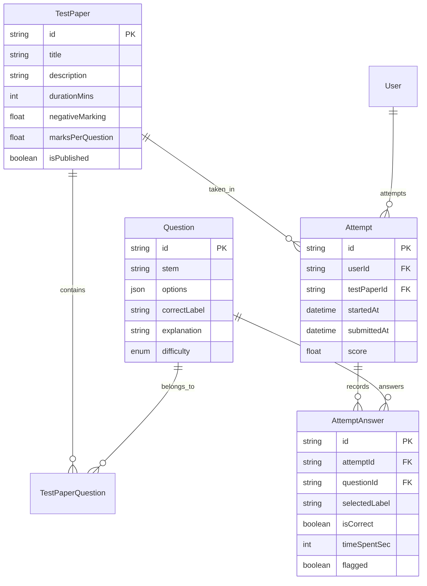

# PRD: UPSC Prelims Mock Test Simulator & Evaluation Engine

**Version:** 1.0 (Draft) | **Date:** October 2026 | **Status:** Ready for Review & Implementation

---

## 1. Executive Summary & Problem Statement

### 1.1 The Problem
UPSC Civil Services Prelims aspirants take dozens of mock tests, but existing test series in the market suffer from critical shortcomings:
1. **Uncalibrated Questions:** Test series often pack arbitrary trivia or coaching-specific bias rather than adhering to true UPSC question patterns (assertion-reasoning, pair-matching, elimination traps).
2. **Generic Scorecards:** Aspirants receive a flat score (e.g., 84/200) with zero diagnostic intelligence about *why* they lost marks — whether due to negative marking over-attempting, misinterpreting statements, or factual gaps.
3. **Clunky Interfaces:** Many test portals rely on slow, ad-heavy, or non-standard interfaces that fail to emulate real exam pressure.

### 1.2 The Solution: Prelims Mock Simulator
A focused, distraction-free, high-fidelity exam simulation environment built on top of our verified UPSC Question Bank and taxonomy. It delivers:
- **Exam Mode:** 100 Questions, 2 Hours, strict UPSC marking scheme (+2.0 per correct, -0.66 per incorrect).
- **Sectional Mode:** 25–50 Questions focused on specific subjects (Polity, Modern History, Economy, Environment, Geography, Science & Tech).
- **Post-Test Diagnostics:** Micro-topic performance breakdown, accuracy vs attempt rate, net loss to negative marking, and verified UPSC solution rationales.

---

## 2. Product Goals & Success Metrics

### 2.1 Goals
- **Realism:** Emulate official UPSC exam conditions (time constraints, section balance, standard marking).
- **Actionable Feedback:** Provide immediate clarity on accuracy, time spent per question, and high-yield weak areas.
- **Speed & Stability:** 100% client-side test taking reliability with auto-save so aspirants never lose progress on connection drops.

### 2.2 Success Metrics
- **Completion Rate:** > 85% of started full-length mocks completed and submitted.
- **Latency:** Zero lag between question transitions (< 50ms).
- **Diagnostic Engagement:** > 70% of test takers review the detailed answer breakdown post-submission.

---

## 3. Product Features & User Experience

### 3.1 Test Catalog (`/prelims/mocks`)
- **Tabs:**
  - **Full-Length Tests:** 100 Questions, 200 Marks, 120 Minutes. Comprehensive GS Paper I coverage.
  - **Sectional Tests:** 25–50 Questions per subject to test depth in single domains.
- **Test Cards:** Display title, total questions, allotted duration, total marks, syllabus coverage, and attempt status ("Not Attempted", "Completed - Score: 94.66").
- **Attempt History Sidebar:** Personal log of previous attempts with dates, scores, and direct links to comprehensive review scorecards.

### 3.2 The Test Taking Interface (`/prelims/[testId]`)
- **Exam Header:**
  - Test Title & Section Indicator.
  - Live Countdown Timer with warning alerts at 15 minutes and 5 minutes remaining.
  - "Submit Test" button with double-confirmation modal displaying summary (Answered, Unanswered, Marked for Review).
- **Question Area:**
  - Clear question stem with support for paired statements (1, 2, 3) and elimination questions.
  - Crisp option choices (A, B, C, D) with single-click selection and "Clear Response" option.
  - "Mark for Review" toggle button.
- **Question Palette (Grid 1–100):**
  - Instant navigation to any question.
  - Standard exam color indicators:
    - Gray: Not visited
    - Amber/Orange: Visited, not answered
    - Green: Answered
    - Purple: Marked for review
    - Purple with Green dot: Answered and marked for review

### 3.3 Post-Submission Scorecard & Review (`/prelims/result/[attemptId]`)
- **Executive Summary:**
  - **Net Score:** `(Correct × 2.0) - (Incorrect × 0.66)`.
  - **Benchmark Status:** Qualified / Borderline / Needs Practice based on current UPSC cutoff benchmarks (~88–92 marks).
  - **Key Metrics:** Total Attempts, Accuracy %, Net Penalty Marks, Average Time per Question.
- **Performance Breakdown:**
  - Subject-wise & Topic-wise accuracy breakdown (e.g., Polity: 80% accuracy, Environment: 45% accuracy).
  - Identification of the "Negative Trap" (how many marks were lost solely due to blind guessing).
- **Interactive Question Review:**
  - Question-by-question walkthrough showing user's answer vs verified official key.
  - Full elimination reasoning and verified explanations.

---

## 4. Technical Architecture & Database Schema

The mock test engine directly utilizes the existing relational schema in Prisma:

### 4.1 Scoring Formula
$$\text{Score} = (\text{Correct} \times \text{marksPerQuestion}) - (\text{Incorrect} \times \text{negativeMarking})$$
- Default GS Paper 1: $\text{marksPerQuestion} = 2.0$, $\text{negativeMarking} = 0.66$.

---

## 5. Phased Rollout Plan

| Phase | Milestone | Deliverables |
|---|---|---|
| **Phase 1 (Immediate)** | **Fix & Architecture Cleanup** | Fix `/prelims/mocks` runtime crashes, unify schema to `TestPaper`/`Attempt`, connect catalog UI to live database. |
| **Phase 2 (Next)** | **Paper Assembly & Ingestion** | Ingest 3 Full-Length UPSC GS Mocks (2022, 2023, 2024 simulated papers) from our 300+ Question bank. |
| **Phase 3** | **Interactive Exam Simulator** | Complete real-time countdown timer, local state persistence (resume test on reload), and palette navigation. |
| **Phase 4** | **Diagnostic Analytics** | Add weak-topic diagnosis, accuracy curves, and cut-off benchmark calculations. |
